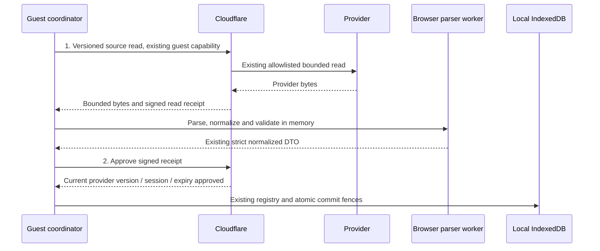

# Guest processing design for Workers Free

Status: approved by the user (I approove, please proceed). Implementation and deployment are pending. The user selected Workers Free after the completed v3 test. This proposal preserves the existing guest feature/data limits; it changes the unreleased source wire protocol and where successful provider payloads are parsed. The user approved that boundary change, including transient raw provider data and the shared global approval budget, in the current turn. This amendment supersedes the successful source-wire portions of the October24 design; normalized DTOs, storage and account-mode contracts remain unchanged. Approved proposal SHA-256: 7b1b2fdfcfd932e18e2b1e4fbae7b5abf3dabf58ec8b8cd4faa392b61384bc74.

## Recommendation and alternative

Move Canvas/Ed parsing and normalization into a short-lived browser worker. Keep Cloudflare as an authenticated, rate-limited, bounded provider relay. After parsing, make a small server approval call that rechecks the admitted provider version before any local result can be accepted. This uses two light server invocations per source operation while moving the expensive parsing off the Worker.

Chunked server parsing is the alternative. Yielding or awaiting within one invocation does not reset its CPU accounting. Separate invocations need a snapshot/continuation design: Canvas is one feed and the Ed client has no verified cursor API. Refetching can produce inconsistent chunks; storing raw coursework server-side conflicts with the local-data design; client-held continuation data introduces its own bounds/protocol complexity. Chunking also has to preserve whole-result duplicate, malformed/partial and output limits. It remains possible, but the browser path has a cleaner existing acceptance seam and avoids new hosted coursework storage.

No local profile establishes that the new relay will fit 10 ms. A changed candidate still needs actual bounded hosted measurement before a Free-capacity conclusion.

## Proposed flow

The current `GuestTransientClient.canvasFeed`, `edCourses` and `edLessons` interfaces still resolve to the existing schema-version-1 normalized DTOs. Both network calls and browser parsing occur inside the original registered promise, before `GuestRequestRegistry.accept`. The store retains its lease, generation, epoch, request-consumption and before-first-mutation checks. IndexedDB, backups, selections, statuses and remembered-secret opt-in stay version 1; no reset or data migration is proposed.

## Server and wire boundary

Use an explicit new source transport version at the existing guest source URLs. Bootstrap/capability and account-mode transports stay unchanged. Retire the old parse-heavy guest wire version cheaply before parser import, provider work or admission writes; do not retain a heavy fallback callable on Free. Mixed old guest tabs receive a fixed compatibility error and can reload without erasing saved data. Guest has not been publicly activated.

The relay retains feature, exact Host/Origin, capability, JSON/request-byte, network identity, admission and provider-control checks. It uses the current fixed transports/redirect allowlists; there is no caller-chosen upstream host/path/header or arbitrary proxy. It enforces the 2 MiB upstream limit on actual bytes and cancels on breach. Successful transport uses a bounded binary body, avoiding base64/escaped JSON amplification and heavy parser imports. Split lightweight wire/request schemas from normalization modules where needed.

Only same-origin guest callers receive transient source bytes. Do not separately forward upstream headers/cookies, credential-bearing URLs in metadata, exceptions or provider error messages. The bounded raw body can itself contain private or credential-bearing URLs, covered by the explicit privacy amendment below. Known HTTP/transport failures retain the fixed safe error envelopes. Some parsing/result-limit failures now occur locally after a successful raw read; the typed client preserves their current source codes and user-facing copy, while the internal versioned HTTP representation changes. The existing v1 normalized-response contract must be explicitly amended for this successful raw channel; it must not be silently labelled normalized success.

Raw ICS and Ed JSON may include private descriptions, profile fields or reflected strings that the current server projection removes. This includes **credential values reflected by the provider**: the browser worker may see them even though the separate original credential input is not sent to it. Raw bytes are not assumed secret-free. Relaying this content to the same user's browser is an explicit privacy-boundary amendment to the existing server-projected DTO contract, and requires design approval. Raw responses are also inspectable in the user's own browser network tools; application code cannot promise immediate physical memory erasure or control user-managed developer-tool retention.

Keep raw bodies and parse intermediates in transient memory only: no snapshots, requests store, credentials store, backup, caches, diagnostics, HTML rendering or storage. Transfer bounded buffers to the parser worker where possible; terminate/drop references on cancellation/completion without promising physical zeroization. Apply the existing strict projection and URL sanitation before returning a DTO. Existing credential RAM/default and explicit remember choice are unchanged. No raw body or parser exception is surfaced as UI text. This explicit consent must not be inferred merely from choosing the Free hosting tier.

## Preserve the post-parse provider fence

The raw response includes a small bounded HMAC read receipt tied to the guest session, audience, operation/course, request UUID, admitted provider version, original checkedAt and original deadline. It contains no source credential or URL. Use an explicitly separated derivation purpose from the existing abuse key; preserve capability/rate-key vectors. No new deployed secret, receipt/nonce row or table is proposed; approval uses existing rate-event claims as described below.

After successful local validation, the approval endpoint verifies the capability and receipt, correlation, audience and expiry, then applies the bounded approval admission below and rechecks the provider control version. Recheck expiry after asynchronous control reads. A disabled/changed provider rejects acceptance. This preserves a server check after parsing instead of claiming that a pre-parse raw emission observes later client work. The approval contains no local assignment rows, performs no upstream request and stores no coursework or continuation. A receipt is not permission to extend an operation or rebind a result to another session/request. Approval attests only the session/version/deadline at that server check; it does not attest parsed data or guarantee provider revocation throughout the subsequent network/local commit. Existing local commit fences remain mandatory.

### Concrete approval-cost policy

Validate origin, capability, receipt signature/correlation and expiry before D1 access. Every valid approval attempt, including a replay, must consume **one claim from the existing shared guest-read global budget of 60 per rolling 600 seconds**, before its provider-control lookup. Do not introduce an independent unlimited approval pool. No additional network/session claims are proposed for approval. Invalid or expired receipts perform zero D1 statements; a valid attempt performs the existing global consume (including its bounded denial/retry lookup where applicable), and only an admitted attempt performs the single provider-control read. No provider fetch is possible on this route.

This bounds admitted approvals/replays and their provider lookups to the same 60-claim global window already shared with relay reads. A two-stage read consumes two global slots; at most 30 complete reads fit an otherwise unused global window, while the existing per-session 30 and network 60 limits are unchanged. This reduces aggregate cross-session throughput and must be an explicit approved operating-policy change, not a hidden feature/input reduction. A replay is charged again and can receive the existing fixed 429/Retry-After; this is not one-time receipt consumption and no new nonce table is proposed.

For the analogous nine-read baseline, expect nine additional global-claim rows: 37 anonymous rows rather than 28, before measuring actual SQL/index cost. The shared global pool does not remove the existing early network/session-claim or bootstrap-churn costs, and denied attempts still consume reads/requests. Measure accepted, replay and denial cost explicitly. A monitored daily allocation including production and eventual cleanup remains necessary within the existing operating decision; this rolling policy is not an account-wide daily-quota guarantee. No migration, new secret, raw-data persistence or blanket billing claim follows from this proposal.

Keep the original fifteen-second source operation fence across both calls, response consumption, parsing and final approval; do not grant each stage a fresh allowance. Receipt expiry is no later than the original server deadline/capability expiry. Cancellation, Stop, tab retirement, reset/import, disconnect/replacement, session change and lease takeover terminate or discard parser jobs, and cannot allow a late approval/result to commit. A dedicated worker is scoped to the foreground operation, not a durable service worker or extension job that completes after tab close.

## Parser compatibility work

Reuse strict normalized response schemas, global count/output-byte limits, duplicate checks, Ed membership/numeric-ID/visibility rules, and Canvas valid-sibling/malformed/empty reporting. Never truncate a source or accept chunks before aggregate validation.

Canvas needs a portable extraction core plus runtime adapters. Retain the exact SHA-256 UTF-8 fallback ID, prefix and U+001F separator; browser Web Crypto is asynchronous and must not change identities. Preserve all-day 23:59 America/Los_Angeles behavior and characterize DST. Floating and unresolved-TZID DTSTART/DTSTAMP currently inherit the server runtime timezone; make the hosted UTC interpretation explicit in the guest browser adapter and compare it with the frozen server result. Do not silently add outer VTIMEZONE support or let unrelated global ICAL state alter results. Check Ed and normalizer date conversion for the same timezone-sensitive forms.

The worker validates before messaging success. The client rechecks correlation/operation clock and existing registry/store fences before acceptance. Post-parse clock checks remain necessary even with timers. Keep malformed UTF-8, multibyte/escaped output boundaries, private-link rejection, safe error copy and last-good-data preservation.

## Independently testable increments after approval

1. Characterize and extract portable parsing with synchronous server and asynchronous browser adapters; prove IDs/order/dates/reports match in Chromium/Firefox and multiple timezones. Existing account-mode callers retain their current interface.
2. Add the versioned bounded relay and signed approval protocol with origin/capability/budget/provider/expiry tests; reject legacy heavy requests. Default guest flag remains off.
3. Integrate the parser worker behind the unchanged client facade; test cancellation, stale ownership, reset/import/replacement/session races and old dataset/backup compatibility. Raw data stays out of persistence and diagnostics.
4. Update sealed native/hosted diagnostics to exercise both calls and actual browser-normalization output. The analogous baseline would have 22 candidate requests rather than 13, with the same ten fixture reads; verify the exact inventory before proposing a fresh action packet. Measure CPU, memory and admission/approval/cleanup costs; no repeated unmodified runs to seek favorable numbers.

Independent ECC/security review and required CI precede merge. Another cloud packet, production deployment, maintenance enablement and public guest activation remain separate concrete decisions. The broader failure/bootstrap-churn, operating-budget, retention and real-provider/lifecycle checks remain in scope; this design neither adds background completion nor waives the existing release checks.
